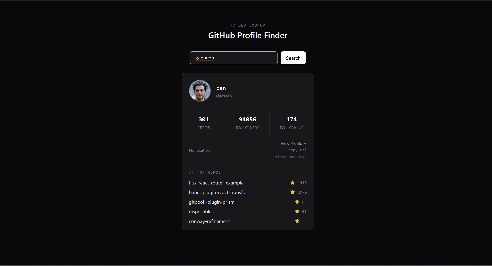

# GitHub Profile Finder

A small web app to look up any GitHub user and see their profile at a glance: avatar, bio, follower stats, location, join date, and their top repositories.

**Live demo:** https://github-profile-finder-eight-liart.vercel.app/



## Features

- Search any GitHub username (press Enter or click Search)
- Profile card with avatar, name, bio, repos / followers / following counts, location and "member since" date
- Top 5 repositories, ranked by stars (forks are excluded)
- Recent search history (last 5, no duplicates) shown as a dropdown for quick re-search
- One-click "copy profile URL" button
- Loading state, "user not found" message, and network error handling
- Responsive dark UI

## Tech Stack

- **React 19** with hooks (`useState`)
- **Vite** for dev server and build
- **Tailwind CSS v4** for styling
- **GitHub REST API** (`/users/:username` and `/users/:username/repos`)
- Plain JavaScript, no UI library

## How It Works

- `useGitHubUser.jsx` is a custom hook that owns the data-fetching logic. It calls the user and repos endpoints **in parallel** with `Promise.all`, then keeps the top 5 non-fork repos sorted by stars.
- `App.jsx` holds the search input and the history list, and renders loading, error and result states.
- `SearchBar.jsx` handles the input, Enter key, and the history dropdown.
- `UserCard.jsx` displays the profile and the repo list.

## Getting Started

```bash
# 1. Clone the repo
git clone https://github.com/sasidamarla/github-profile-finder.git
cd github-profile-finder

# 2. Install dependencies
npm install

# 3. Start the dev server
npm run dev
```

Then open the local URL that Vite prints (usually `http://localhost:5173`).

Other scripts:

```bash
npm run build     # production build into dist/
npm run preview   # preview the production build locally
npm run lint      # run ESLint
```

## Project Structure

```
src/
├── App.jsx             # main component: search state, history, layout
├── SearchBar.jsx       # input + history dropdown
├── UserCard.jsx        # profile card + top repos
├── useGitHubUser.jsx   # custom hook: API calls, loading and error state
├── main.jsx
└── index.css
```

## Notes

The app uses GitHub's public API without authentication, which allows about 60 requests per hour per IP. If you hit the limit, wait a bit and try again.

## Author

**Sasi**: [GitHub](https://github.com/YOUR-USERNAME)
